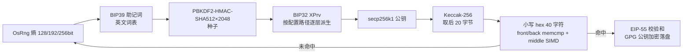

# 以太坊靓号地址生成器

一个完全离线运行的以太坊靓号地址生成器：按 BIP39/BIP32 标准生成助记词与派生地址，
多线程全速搜索符合自定义前缀/中缀/后缀规则的地址，命中后立即用你的 GPG 公钥加密
落盘。熵源只使用操作系统安全随机数（`OsRng`），助记词与私钥全程不落明文、不出内存，
加密文件只有持有对应私钥的人能解开。单二进制交付，行为全部由 `config.yaml` 驱动。

## 安装

```bash
cargo build --release
# 产物：target/release/vanity-generator（或从 Release 页面下载对应平台的压缩包）
```

Release 页面提供 Linux（musl，静态链接）/ Windows（MSVC）/ macOS（x86_64 与
Apple Silicon）的预编译二进制，解压后与 config.yaml 放在同一目录即可直接运行。

## 使用

可执行文件与 `config.yaml` 放在同一目录，直接运行：

```bash
./vanity-generator                 # 读取同目录 config.yaml
./vanity-generator --config /path/to/config.yaml
```

也支持环境变量注入（优先级高于同目录文件，适合 CI 与容器）：

- `VANITY_CONFIG`：config.yaml 的**完整内容**
- `VANITY_GPG_KEY`：GPG 公钥 armor 的**完整内容**（兜底来源；仅当 config.yaml 未填
  `gpg_key_file` 时生效，配置文件优先以防环境变量注入）

config.yaml 完整示例（仓库根目录同附 `config.example.yaml`）：

```yaml
# 助记词词数：只允许 12 / 18 / 24
word_count: 24
# 靓号规则（至少定义一个）：front 前缀 / middle 任意包含 / back 后缀
# 去掉 0x 后匹配；同时定义时必须同时满足
front: "8888"
back: "8888"
# 大小写敏感（默认 false）：true 时按 EIP-55 校验和形式匹配，
# 如 front: "AaAaAa" 只命中 0xAaAaAa…，0xaaaaaa… 不命中
case_sensitive: false
# 每尝试 N 次输出一行进度（总数/速率/耗时）；false 禁用
progress_every: 100000
# BIP32 派生路径，不填默认 m/44'/60'/0'/0/0
path: "m/44'/60'/0'/0/0"
# 目标命中数量（1..=1000），每命中一个立即加密落盘后继续
count: 5
# GPG 公钥文件（相对可执行文件目录，后缀名不限，纯文本 armor 即可）
gpg_key_file: "fx1024.asc"
```

命中后生成的 `vanity_日期_时间_序号.asc` 是 ASCII Armor 加密文件，可在任何装有
GnuPG 的机器上解密：`gpg --decrypt vanity_xxx.asc > wallet.txt`。

只想验证配置而不开始搜索：`./vanity-generator --check`，会输出规则难度预估
（期望尝试次数与参考耗时），难度过高会直接提示。

可选性能配置（config.yaml）：

- `threads: N`（1..=1024）：自定义工作线程数；不填则自动按 **CPU 逻辑核心数**
  分配（含超线程，4 核 8 线程 → 8）
- `derive_batch: N`（默认 1）：**批派生提速**——一个助记词派生
  `m/44'/60'/0'/0/0..N-1` 共 N 个地址参与匹配（MetaMask 多账户同款设计），
  单机吞吐约提升 N×0.7 倍（实测 N=8：433/s → 2457/s，5.7×）。
  熵强度不变（详见 docs/security-audit.md 第三节）；注意：批派生的多个地址
  共享同一助记词，**备份助记词 = 备份全部 N 个地址**（导入 MetaMask
  对应账户即可恢复）。

## 关于 GPG 的使用
gpg支持两种加密方法，分别是对称加密和非对称加密。此项目使用的是非对称加密原理。

和你使用网站时的加密一样，公钥加密，私钥解密。你在你的本地生成一对公私钥，公钥是公开的可以随便往外发，私钥千万不要泄露或发网上

之后你的联络人拿到了你的公钥后，他使用你的公钥对消息进行加密，加密后的密文只有使用你的私钥才能够解密。这就是非对称加密的原理。

### 如何查看公钥：
首先，使用以下命令查看你本地的公钥列表：
```
gpg -k
```
输出里：
- pub：公钥指纹，就是第二行那一长串的字符
- uid: 公钥信息，如名字、邮箱

然后导出公钥
使用公钥信息中的邮箱导出：`gpg --armor --export example@example.com > my_public_key.asc`

使用公钥指纹导出，更精确：`gpg --armor --export 742F1C003D4981177012EEF9BF590F26C1B8D4B5 > my_public_key.asc`

若不加`>`时，你的公钥将直接打印到终端中

### 如何查看私钥：

**请注意私钥千万不可以泄露给他人**

```
gpg --armor --export-secret-keys you@example.com > private.asc
```

### 如何使用本地私钥，来解密别人用你的公钥加密的消息：

```
gpg --decrypt privatemessage.gpg
```

### 如何使用别人的公钥来加密你要发送的消息

导入他人的公钥

```
gpg --import he_public_key.asc
```

然后可以确认导入结果，并查看他公钥中的邮箱信息

```
gpg --list-keys
```

用他的邮箱或名称作为收件人标识来加密

```
gpg --encrypt --recipient example@gmail.com 文件名
```

这会生成一个 文件名.gpg 的加密文件。你只需要把 文件名.gpg 发回给他，原始文件不需要一起发。

如果导入公钥后加密时报“没有找到有效公钥”，通常是因为没有设置信任级别。可以执行：

```
gpg --edit-key example@gmail.com
gpg> trust
```

选择 5 = I trust ultimately，确认后退出即可。

### 加密过后删除他人的公钥

你可以使用对方的邮箱、用户ID或密钥指纹来指定要删除的公钥。

方法一：使用邮箱或用户ID

```
gpg --delete-key fx1024hi@gmail.com
```

执行后，GPG会显示密钥详情并询问是否确认删除，输入 y 并回车即可。

方法二：使用密钥指纹（更精确）

如果你知道对方的密钥指纹，使用指纹删除可以避免歧义：

```
gpg --delete-key 742F1C003D4981177012EEF9BF590F26C1B8D4B5
```

如果同时导入了对方的私钥（这种情况很少见，但如果你有自己的密钥对且导入过别人的私钥），删除顺序很重要。GPG要求先删除私钥，再删除公钥。

先删除私钥：

```
gpg --delete-secret-key fx1024hi@gmail.com
```
再删除公钥：

```
gpg --delete-key fx1024hi@gmail.com
```

你也可以使用组合命令 --delete-secret-and-public-key 一次性完成，但GPG仍会按先私钥后公钥的顺序处理

删除后，运行以下命令确认公钥已从钥匙环中移除： `gpg --list-keys`，如果列表中没有该用户ID或指纹，说明删除成功

## 生产环境 PGO（按本机负载定制二进制）

编译器默认按"通用分支概率"优化；PGO 用真实运行统计纠正它，对分支密集的密码学热路径通常有可测增益（本项目 CI 实测数字见 Actions 的
「PGO 性能对比」工作流）。三步：

```bash
# ① 插桩构建（计数器会随运行累积）
RUSTFLAGS="-Cprofile-generate=/tmp/pgodata" cargo build --release --offline

# ② 训练：用你真实的搜索负载跑几分钟（规则/线程数与生产一致；
#    进程必须自然退出——插桩数据只在退出时落盘，别用 kill）
mkdir -p /tmp/pgodata
export VANITY_CONFIG="$(cat config.yaml)"   # 你自己的配置
./target/release/vanity-generator &         # 跑到命中 count 自然结束

# ③ 合并 profile 并重建（llvm-profdata 由 rustup 组件提供）
rustup component add llvm-tools-preview
PROFDATA=$(find ~/.rustup -name llvm-profdata | head -1)
"$PROFDATA" merge -sparse /tmp/pgodata/*.profraw -o /tmp/vanity.profdata
RUSTFLAGS="-Cprofile-use=/tmp/vanity.profdata" cargo build --release --offline
```

要点：

- 训练负载要**代表生产**（同样的规则难度与 derive_batch 设置），否则
  profile 会误导优化器
- 多台不同 CPU 的机器请分别训练（profile 反映的是指令缓存/分支行为，
  跨机复用收益会打折）
- 重建产物与普通构建**行为完全一致**（PGO 只改变代码布局与分支预测
  提示，不改变语义）——用 `cargo test --release` 复核后即可替换部署
- 收益门槛：±3% 以内多为噪声，≥2% 才值得维护 profile 文件
- 诚实参考：本项目 CI 实测 PGO 收益 ±0.4%（噪声级）——派生负载的
  SHA-512 压缩是紧凑直线代码、分支行为极稳定，PGO 无用武之地；
  若你的生产机（如 AMD Zen4/Intel 新架构）想再压一把，跑一次
  `pgo.yml` 同款流程实测后再决定


## 多核/多机部署调优（硬件视角）

长时间高并发搜索时，让程序"对 CPU 友好"的部署层手段（零代码改动）：

```bash
# ① CPU 亲和：把进程钉在指定核上，减少迁移带来的 L1/L2 失效
#    （容器里 cpuset 已天然限核，此招对裸机收益最明显）
taskset -c 0-3 ./vanity-generator

# ② NUMA 系统（多路服务器）：优先本地内存 + 本地核
numactl --cpunodebind=0 --membind=0 ./vanity-generator

# ③ 线程数建议：threads 默认 = 逻辑核数（含超线程）。纯 ALU 密集的
#    派生负载在部分架构上"物理核数"反而更稳（超线程同胞争用执行端口），
#    可各测一轮取快者
```

程序内部已做的硬件友好设计：共享计数器独占缓存行（防伪共享）、匹配器
栈缓冲 + memcmp 前置剪枝 + SIMD 中缀搜索（`memchr` 运行时 AVX2）、
命中才计算 EIP-55 校验和、批派生摊销种子成本（`derive_batch: 8`）。
生产二进制可再叠加 PGO（见上文「生产环境 PGO」）。

## Docker 部署

```bash
# 1. 准备 ./config 目录：config.yaml（gpg_key_file 填 /config/gpg.asc 绝对路径）+ gpg.asc
# 2. 一键启动（限 2 核 / 512MB、禁用网络、命中 count 个地址后自动退出停止）：
docker compose up -d
# 命中的加密文件（vanity_*.asc）会出现在 ./config/ 目录
```

或直接拉取镜像（CI 自动构建并发布）：

```bash
docker pull ghcr.io/sweetsky123/vanity-generator:latest
docker run --rm --network none -v ./config:/config \
  ghcr.io/sweetsky123/vanity-generator --config /config/config.yaml
```

镜像为 scratch 静态二进制（约 3.4MB），构建使用 vendor 内置依赖（零网络下载，
中国大陆机器友好）。

## CI 多机并行演示

仓库自带手动触发的多机并行工作流（Actions → 靓号演示（多机并行·共同目标）→ Run workflow）：

1. 在仓库 Settings → Secrets and variables → Actions 配置两个 Secret：
   - `config`：config.yaml 的完整内容
   - `gpg`：GPG 公钥 armor 的完整内容
2. 触发时可选：**并行机器数**（1-20，默认 8）与每台机器的搜索时限（默认 15 分钟）
3. **共同目标机制**：全部机器共同凑齐 config 中 `count` 指定的地址数量。
   每台机器命中后立即把加密产物上传到演示 Release，所有机器持续轮询
   全局命中数，达标即全部停止（在途的超额命中会保留，通常仅 0-1 个/机）。
   机器按规则难度**自适应错峰启动（性能无损）**：目标数 ≥ 2×机器数时
   全并行零延迟；目标数较少时按"单机预计完成时长 ×2.5（上限 45 秒）"
   错峰——该情形总时长本就只有秒级～分钟级，后启机器达标即跳过，
   总命中可精确停在目标数量
### 版本发布与重新发布规范（2026-10-11 重构）

- **发布方式**：Actions → Release → Run workflow → 填版本号（如 `v0.2.0`，
  留空自动读 `Cargo.toml`）。流程为 **构建全绿 → publish 阶段才创建 tag
  与 Release**：构建失败零残留（不产生任何 tag/Release）。
- **重复发布同一版本**：幂等补传（仅覆盖同名资产），永不删除既有
  Release；资产已完整时默认跳过，勾选 `force` 强制重建。
- **旧习惯兼容**：手动 `git push tag v*` 仍可触发；但若该 tag 的
  Release 已存在会自动跳过（防双跑）。**不建议**删除/强推已发布 tag
  ——GitHub 平台行为是"删 tag 连带删 Release"，且发生在工作流之前
  无法拦截。
- **本地构建验证**：`cargo build --release` 后运行 `./target/release/vanity-generator`；
  五平台产物由 CI 交叉构建（linux x86_64/aarch64 musl、windows、macos）。
- 仓库事件流（`GET /repos/{owner}/{repo}/events`）保留全部 Release
  删除审计记录（DeleteEvent 带操作者与时间）。

4. **演示发布形态（v6，2026-10-11 重构）**：每场演示对应独立标签
   `demo-run-{N}`（N = 运行编号），**仅在整理发布阶段、且确有命中时才
   创建** tag 与 Release（零命中零残留）；预发布（prerelease）不占用
   Latest。机器间通过 commit status 共享全局命中计数（达标即停不变），
   产物经 artifact 汇总后统一上传。
5. **演示历史一键清理**：Actions → 清理演示 Release（demo-run-*）→
   保留最近 N 场（默认 5），支持 dry_run 预览；仅触碰 `demo-run-*` 前缀，
   绝不影响版本 tag 与 Release；`remove_legacy` 可选删除废弃的
   `demo-latest` 固定标签（v6 起不再使用）。

## 常见问题

- **演示一直不命中**：先看演示 Release 附件 log-machine-1.log 中"期望尝试"一行；
  若参考耗时远超时限，属规则过难，请缩短前/后缀或加长时限。
- **规则难度怎么估**：前缀/后缀每多一位 hex 字符，期望次数 ×16；
  大小写敏感时每个字母位再 ×2；前缀与后缀叠加相乘。
- **如何生成自己的 GPG 公钥**：`gpg --armor --export 你的邮箱 > mykey.asc`，
  把文件内容整个放进 `gpg` Secret 或与二进制同目录。
- **Windows**：解压 zip 后，把 config.example.yaml 改名为 config.yaml，
  与 vanity-generator.exe 放同一目录再运行（或在 PowerShell 里 `.\vanity-generator.exe --check` 验证）。
- **进度行没有出现**：两种常见原因——①总尝试数低于阈值（如规则期望 4096 次
  而 progress_every: 100000，全程不会触发任何一行，启动日志与结束提示会
  说明预计行数；演示短任务建议 5000）②确认 `progress_every` 为正整数、
  `false` 为关闭。

## 工作原理



每次尝试从熵开始完整走一遍 BIP39 → BIP32 → secp256k1 → Keccak 链路（与
MetaMask 行为对齐：英文词表、空 passphrase、m/44'/60'/0'/0/0）。命中前地址
匹配全部在栈上 40 字节缓冲内完成，零堆分配；命中后才计算 EIP-55 校验和并进入
加密流程，未命中的敏感数据随作用域结束擦除（Zeroizing）。

## 性能

基准环境：2 vCPU 云虚拟机（实测等效约 1 个物理核）。
单次尝试成本分解（`examples/perf_probe`，24 词）：
PBKDF2×2048 轮 1.77ms（77%）+ BIP32 派生 0.40ms + 公钥/Keccak/匹配 0.18ms，
合计约 2.3ms/次。PBKDF2 是 BIP39 标准的固定成本，本项目不做任何省略，
详见 `docs/performance.md`（含优化 A/B 记录与浏览器工具对比说明）。

| 配置 | 吞吐 |
|---|---|
| 单核（24 词） | 约 450 addr/s |
| N 核机器（默认全速多线程） | 约 380×N addr/s（扩展性 ≥ 0.7×N，CI 真多核门禁验证） |
| 12 词（单核） | 约 460 addr/s（词数对成本影响很小） |
| 匹配器单次判定（front 剪枝） | 约 15 ns |

预期查找时间（按单核 450 addr/s，16^n 均匀分布取期望值；多核按核数近线性折算）：

| 前缀长度 | 期望尝试次数 | 单核期望耗时 | 8 核期望耗时 |
|---|---|---|---|
| 2 位 | 256 | 约 0.6 秒 | 约 0.1 秒 |
| 4 位 | 65 536 | 约 2.4 分钟 | 约 18 秒 |
| 6 位 | 1 677 万 | 约 10 小时 | 约 1.3 小时 |
| 8 位 | 43 亿 | 约 111 天 | 约 14 天 |

## 安全说明

- **完全离线**：除读写本地文件外无任何网络行为，私钥不离开内存。
- **熵源**：仅使用操作系统安全随机数（`getrandom`/`OsRng`），熵源失败时
  fail-closed 直接终止，绝不降级。对照 Profanity 事故：其 32 位用户态熵被
  2^32 枚举攻破，本工具不存在此类缩短路径。
- **加密输出**：结果用你的 GPG 公钥（sequoia-openpgp 实现，输出与 GnuPG 兼容）
  加密后落盘，运行机器上不会出现明文助记词文件。
- **内存擦除**：熵、种子、助记词、加密前明文均用 Zeroizing 包裹，用完即擦。
- **长靓号的代价**：前缀每多一位，期望尝试次数 ×16；被破解的难度随之下降，
  请按需选择长度，避免为炫技搜索超长前缀。

## 测试

| 层级 | 内容 |
|---|---|
| 单元 | BIP39 官方向量（12/18/24 词）、BIP32 官方向量 1、确定性派生地址（与独立 Python 实现双互验）、EIP-55 官方样例、私钥边界 0/n 拒绝、非法配置矩阵 |
| 集成 | gpg 命令行生成密钥→本工具加密→gpg 解密回验；fx1024 包结构校验；确定性 RNG 10000 次可重现；2 字符前缀 10000 次内命中 |
| 基准 | criterion：匹配器分解耗时、单线程全链路、2/4/8 线程吞吐（多线程加速比 ≥ 0.7×线程数） |

本地运行：`cargo test`（快速）、`cargo test --release -- --ignored`（重量级）、
`cargo bench`。

## 许可证

MIT
